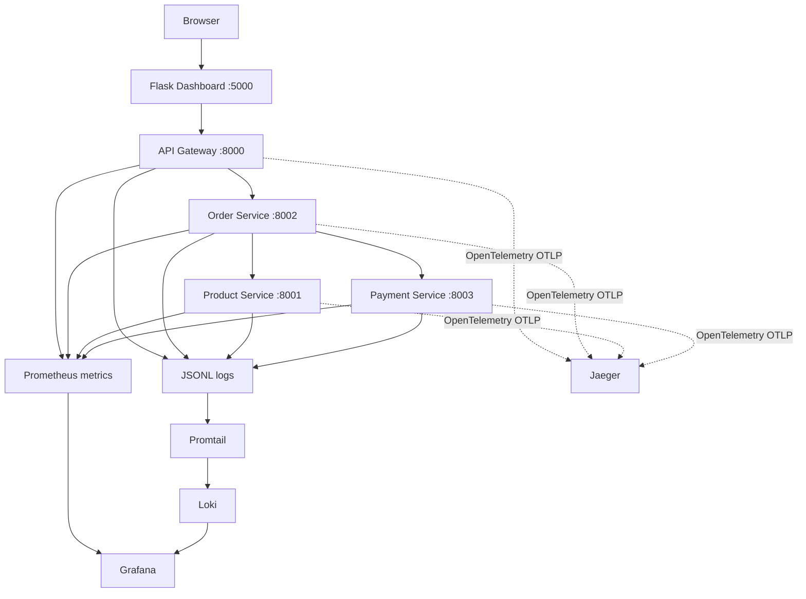

# Architecture

Metrics answer what is changing, logs describe specific events, and traces show the path and duration of a request across services. The incident workflow uses a metric to spot an issue, a trace to narrow the slow operation, and logs to inspect relevant errors.
